# flashdrop: Learning Notes

Questions and answers from building flashdrop, organized by phase. Each answer is written to be useful as interview prep: the concept, a diagram where it helps, and a one-line "interview answer" at the end.

> Diagrams use [Mermaid](https://mermaid.js.org/), which GitHub renders automatically. In IntelliJ, enable the Mermaid option in the Markdown plugin settings to see them in the preview.

## Contents

- [Phase 0: Setup and Foundations](#phase-0-setup-and-foundations)
  - [Q1. What goes wrong when two users buy the last item at the same time?](#q1-what-goes-wrong-when-two-users-buy-the-last-item-at-the-same-time)
  - [Q2. How does the code know which user won the atomic UPDATE?](#q2-how-does-the-code-know-which-user-won-the-atomic-update)
  - [Q3. How do Docker port mappings work, and how do I find a port?](#q3-how-do-docker-port-mappings-work-and-how-do-i-find-a-port)
  - [Q4. How does a property name like `spring.data.redis.host` turn into YAML?](#q4-how-does-a-property-name-like-springdataredishost-turn-into-yaml)
  - [Q5. Why package by feature instead of by layer?](#q5-why-package-by-feature-instead-of-by-layer)
  - [Q6. What is Hibernate, and why use Flyway with `ddl-auto: validate` instead of `update`?](#q6-what-is-hibernate-and-why-use-flyway-with-ddl-auto-validate-instead-of-update)
  - [Q7. What happens if I add an entity field but forget the migration?](#q7-what-happens-if-i-add-an-entity-field-but-forget-the-migration)
- [Phase 1: Domain Model](#phase-1-domain-model)
  - [Q8. Should stock live on Product or in a separate Inventory table?](#q8-should-stock-live-on-product-or-in-a-separate-inventory-table)
  - [Q9. Why not FLOAT/DOUBLE for money?](#q9-why-not-floatdouble-for-money)
  - [Q10. Why add CHECK constraints if Java already validates?](#q10-why-add-check-constraints-if-java-already-validates)
  - [Q11. TIMESTAMPTZ vs TIMESTAMP: why does the time zone matter?](#q11-timestamptz-vs-timestamp-why-does-the-time-zone-matter)
  - [Q12. Why not store times as epoch numbers?](#q12-why-not-store-times-as-epoch-numbers)
  - [Q13. Why no `IF NOT EXISTS` in Flyway migrations?](#q13-why-no-if-not-exists-in-flyway-migrations)
  - [Q14. Why store `available_units` instead of computing it from orders?](#q14-why-store-available_units-instead-of-computing-it-from-orders)
  - [SQL patterns cheat sheet](#sql-patterns-cheat-sheet)
  - [Q15. What do `@Id` and `@GeneratedValue(strategy = IDENTITY)` mean?](#q15-what-do-id-and-generatedvaluestrategy--identity-mean)
  - [Q16. What do the entity annotations and Lombok's `@Getter` do?](#q16-what-do-the-entity-annotations-and-lomboks-getter-do)
  - [Q17. Why `@ManyToOne Product product` instead of `Long productId`, and what does LAZY do?](#q17-why-manytoone-product-product-instead-of-long-productid-and-what-does-lazy-do)
  - [Q18. `EnumType.ORDINAL` vs `EnumType.STRING`](#q18-enumtypeordinal-vs-enumtypestring)
  - [Q19. What are these classes called, and what should a constructor guarantee?](#q19-what-are-these-classes-called-and-what-should-a-constructor-guarantee)
  - [Java and SQL type mapping cheat sheet](#java-and-sql-type-mapping-cheat-sheet)
  - [Q20. Why does Inventory have no `@GeneratedValue`?](#q20-why-does-inventory-have-no-generatedvalue)
  - [Q21. Why does Inventory store `Long dropId` instead of a `Drop` object?](#q21-why-does-inventory-store-long-dropid-instead-of-a-drop-object)
  - [Q22. OOP in flashdrop, with real-life examples](#q22-oop-in-flashdrop-with-real-life-examples)
  - [Q23. Order: the starting status, and who owns `createdAt` vs `updatedAt`](#q23-order-the-starting-status-and-who-owns-createdat-vs-updatedat)
  - [Q24. Where should a rule like "only SCHEDULED drops can go LIVE" live?](#q24-where-should-a-rule-like-only-scheduled-drops-can-go-live-live)
- [Mistakes Log](#mistakes-log)

---

## Phase 0: Setup and Foundations

### Q1. What goes wrong when two users buy the last item at the same time?

```java
Inventory inv = repo.findById(id);
if (inv.getStock() > 0) {
    inv.setStock(inv.getStock() - 1);
    repo.save(inv);
}
```

**Answer.** Both requests read `stock = 1` before either one writes. Both pass the `if` check, both compute `1 - 1 = 0`, and both save `0`. The stock ends at **0, not -1**, so the database looks healthy, but **two items were sold when only one existed**. That's what makes the bug dangerous: nothing looks wrong until two customers both expect the item.

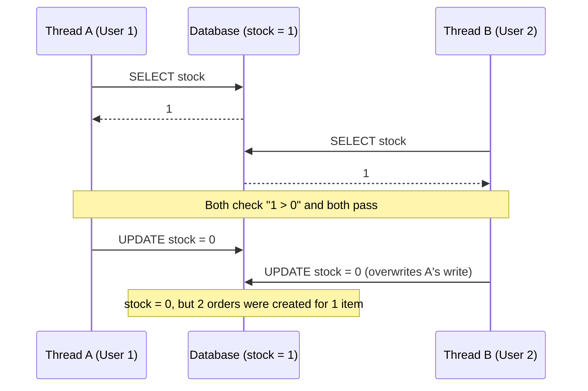

**Vocabulary**

| Term | Meaning |
|---|---|
| Race condition | The result depends on the timing of threads |
| Check-then-act | The check (`if`) and the action (update) are separate steps, so another thread can run in between them |
| Lost update | One write silently overwrites another write that was based on the same old value |

**Three fixes** (built and benchmarked in Phase 2)

| Strategy | How it works | What the losing request experiences |
|---|---|---|
| Pessimistic lock | `SELECT ... FOR UPDATE` locks the row until the transaction ends | It waits, then reads `stock = 0` |
| Optimistic lock | A `@Version` column; the update succeeds only if the version is unchanged | Its save fails, so it retries or gives up |
| Atomic conditional update | `UPDATE ... SET stock = stock - 1 WHERE id = ? AND stock > 0` | It updates 0 rows, which means sold out |

> **Interview answer:** "It's a check-then-act race that causes a lost update. Both threads read the same stale value, so we oversell while the stock still looks correct. I'd fix it with a pessimistic lock, an optimistic version check, or an atomic conditional UPDATE, depending on how much contention there is."

---

### Q2. How does the code know which user won the atomic UPDATE?

**Answer.** An `UPDATE` returns the **number of rows it changed**. The database applies the two updates to the row one at a time. The first one matches `stock > 0` and changes 1 row. The second one sees `stock = 0`, matches nothing, and changes 0 rows.

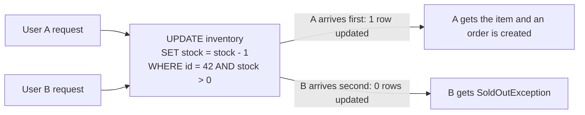

```java
@Modifying
@Query("UPDATE Inventory i SET i.stock = i.stock - 1 WHERE i.id = :id AND i.stock > 0")
int decrementIfAvailable(@Param("id") Long id);   // returns rows affected

int updated = inventoryRepo.decrementIfAvailable(id);
if (updated == 0) {
    throw new SoldOutException(id);
}
```

**Why it works:** the check and the write happen in **one atomic statement inside the database**. There's no gap between them for another request to slip into.

> **Interview answer:** "I push the check into the WHERE clause so the database enforces it atomically, and I use the affected-row count to decide whether this request won."

---

### Q3. How do Docker port mappings work, and how do I find a port?

**Answer.** In `docker-compose.yml`, `ports` uses the format **`HOST:CONTAINER`**.

```yaml
ports:
  - "6379:6379"
#    ↑      ↑
#  laptop  container
```

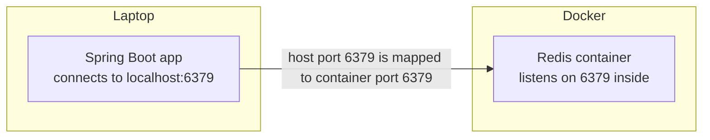

The app connects to the **left** (host) number. With `"6380:6379"`, the app would use `localhost:6380`, while Redis still listens on 6379 inside the container.

**Three ways to find a port**

1. Read the `ports:` entry in `docker-compose.yml`.
2. Run `docker compose ps` and look at the PORTS column, for example `0.0.0.0:6379->6379/tcp`.
3. Know the defaults:

| Service | Default port |
|---|---|
| Redis | 6379 |
| PostgreSQL | 5432 |
| MongoDB | 27017 |
| Kafka | 9092 |
| Spring Boot | 8080 |

**Related gotchas**
- Editing `docker-compose.yml` doesn't start anything. Run `docker compose up -d` afterwards.
- `./mvnw spring-boot:run` keeps running in the foreground. Run `curl` from a **second terminal** while the app is up.

---

### Q4. How does a property name like `spring.data.redis.host` turn into YAML?

**Answer.** Each dot becomes one level of indentation, and **only the value** goes after the last colon. The property name never appears as text inside the YAML. **The indentation is the name.**

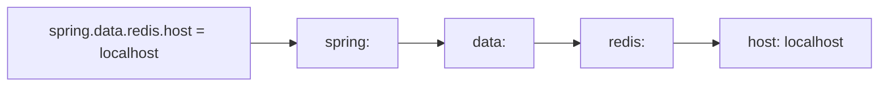

| `.properties` (one line) | YAML (nested) |
|---|---|
| `spring.data.redis.host=localhost`<br/>`spring.data.redis.port=6379` | <pre>spring:<br/>  data:<br/>    redis:<br/>      host: localhost<br/>      port: 6379</pre> |

**Rules**
- Indent with spaces, never tabs. Siblings must line up exactly.
- `host` is only the machine name (`localhost`). The port goes on its own line.
- A wrong path such as `spring.redis.host` doesn't crash the app. Spring Boot just **ignores** it and uses defaults, so the app can look like it works while your config is being ignored.

---

### Q5. Why package by feature instead of by layer?

```
By layer                          By feature (flashdrop)
├── controllers/                  ├── catalog/
│   ├── OrderController           ├── inventory/
│   └── InventoryController       │   ├── InventoryController
├── services/                     │   ├── InventoryService
│   ├── OrderService              │   ├── InventoryRepository
│   └── InventoryService          │   └── Inventory
└── repositories/                 ├── order/
    ├── OrderRepository           ├── payment/
    └── InventoryRepository       └── common/
```

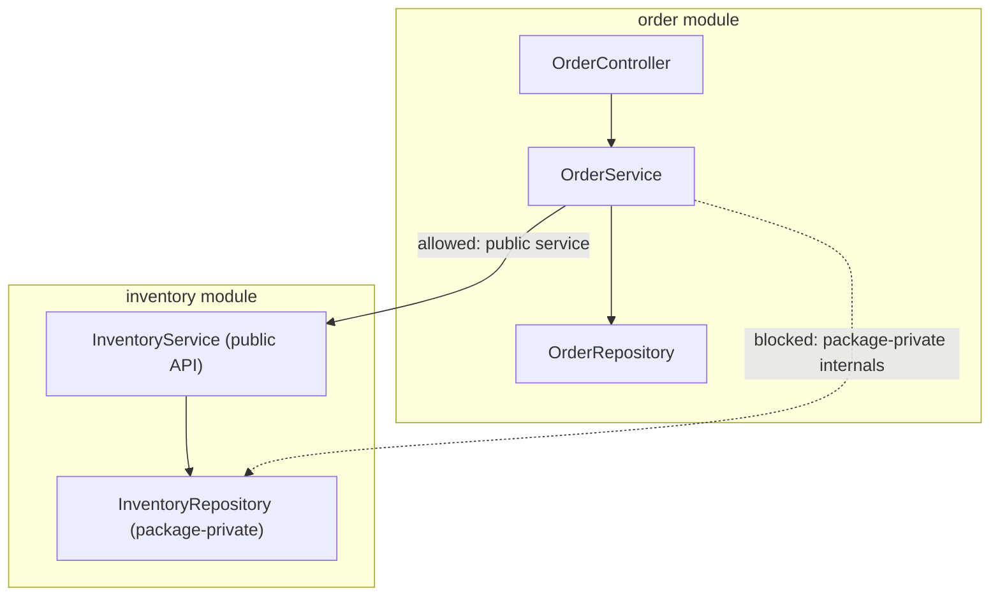

**Answer.**
1. **High cohesion.** Everything about a feature lives in one folder. A change to order logic touches one place instead of four folders.
2. **Encapsulation.** Classes can be package-private (no `public` keyword), so other modules have to go through the feature's public service and can't reach into its internals.
3. **Easy extraction.** Moving `payment/` into its own microservice (Phase 4) is roughly "move one folder". With package-by-layer, payment code would be spread across every layer folder.

Smaller files are a side benefit, but layered packaging also gives you separate files, so that isn't the main reason.

> **Interview answer:** "I package by feature for high cohesion and clear module boundaries. That keeps changes local and lets each module be extracted into a service later."

---

### Q6. What is Hibernate, and why use Flyway with `ddl-auto: validate` instead of `update`?

**What Hibernate is.** JPA is the Java standard for mapping classes to database tables. **Hibernate is the library that implements JPA**, and it comes with `spring-boot-starter-data-jpa`. It reads `@Entity` classes and generates the SQL for `save()`, `findById()` and so on.

```java
@Entity
class Inventory {
    @Id Long id;
    int stock;      // maps to the inventory.stock column
}
```

**What `ddl-auto` controls:** whether Hibernate may create or change tables.

| Value | What Hibernate does |
|---|---|
| `create` / `create-drop` | Drops and recreates tables on every start (all data lost) |
| `update` | Adds whatever is missing compared with the entities |
| `validate` | Changes nothing. Checks that tables match the entities and refuses to start if they don't |
| `none` | Does nothing |

**Why not `update`?**
- **It only adds and never cleans up.** Renaming `stock` → `quantity` adds a new empty column and leaves the old one, with its data, behind.
- **It can't migrate data**, for example filling a new column from existing rows.
- **There's no history and no review.** Environments drift apart, and nobody knows what changed when.
- **It's unsafe in production.** Teams don't let an app change production tables on startup.

**Who does what in flashdrop**

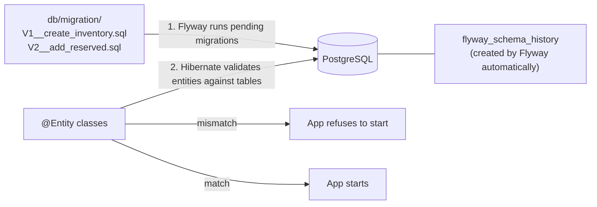

**Do I need to create a table to track migrations?** No. Flyway creates `flyway_schema_history` automatically on first run. It records which `V…` files have already been applied, so each migration runs exactly once.

> **Interview answer:** "Schema changes are versioned SQL migrations in Git, run by Flyway and reviewed in PRs. Hibernate is set to `validate`, so if an entity doesn't match the schema, the app fails fast at startup instead of in production."

---

### Q7. What happens if I add an entity field but forget the migration?

**Scenario:** with `ddl-auto: validate`, you add `private int reserved;` to `Inventory` but don't write a Flyway migration.

**Answer.** The app **refuses to start**, with an error like:

```
Schema-validation: missing column [reserved] in table [inventory]
```

The important part is **when** it fails: at startup, on your laptop, within seconds. Not in production, when a customer's request finally reaches that code path. That's the "fail fast" principle.

---

## Phase 1: Domain Model

### Q8. Should stock live on Product or in a separate Inventory table?

**Answer.** In a separate `inventory` table, **one row per drop**. The same product (a sneaker) can be released in several drops (500 units in March, 1000 in June), so stock belongs to the drop, not the product.

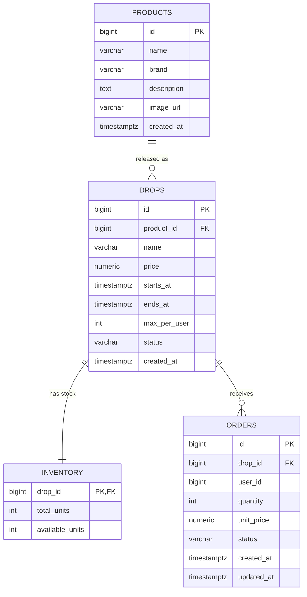

**The deeper reason: separate data that changes often from data that rarely changes.**

| | Product | Inventory |
|---|---|---|
| Describes | *What* is sold | *How many* are left |
| Change rate | Rarely | Thousands of writes per second during a drop |
| Access pattern | Read-heavy, cacheable | Write-heavy, contended, needs locking |

If `stock` lived on `Product`, every purchase would lock the product row, and even viewing the product page would compete with buyers. Splitting them is Single Responsibility at the data level. It also lets `Product` move to MongoDB later while `Inventory` stays in Postgres for ACID guarantees.

> **Interview answer:** "I separate frequently written data from rarely written data. Inventory is a contended, write-heavy row per drop, while the product is read-heavy and cacheable, so locking one never blocks the other."

---

### Q9. Why not FLOAT/DOUBLE for money?

**Answer.** Floating-point numbers are stored in **binary**, and most decimal values (like `0.1`) have no exact binary representation, just as 1/3 has no exact decimal form.

```java
System.out.println(0.1 + 0.2);   // 0.30000000000000004
```

Across millions of transactions, these errors add up to real money discrepancies.

| Layer | Use | Never use |
|---|---|---|
| PostgreSQL | `NUMERIC(10, 2)`: exact, 10 digits with 2 after the decimal point | `REAL`, `DOUBLE PRECISION` |
| Java | `BigDecimal` | `double`, `float` |

> **Interview answer:** "Floats are binary approximations, so decimal amounts like 0.1 can't be represented exactly and rounding errors accumulate. I use NUMERIC in the database and BigDecimal in Java."

---

### Q10. Why add CHECK constraints if Java already validates?

**Answer.** Java validation only protects the code paths that go through that Java code. A database constraint protects against **every** writer.

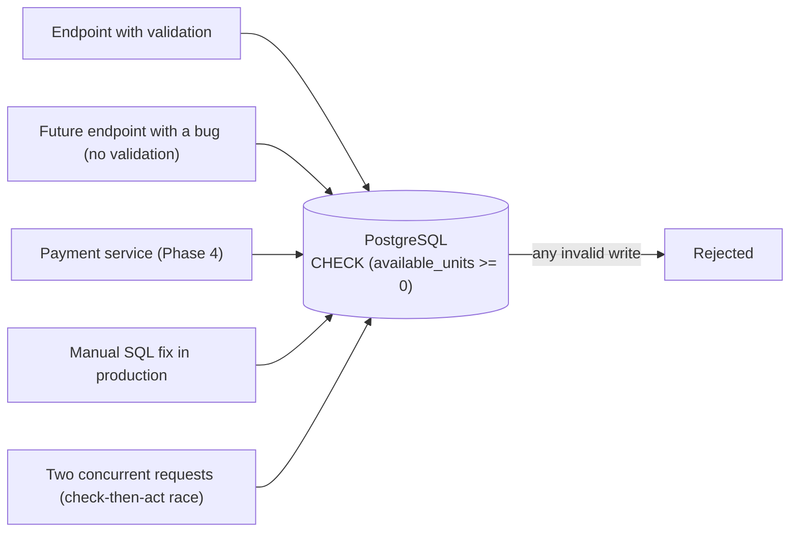

The race-condition case matters most here. Java's `if (available >= 1)` is a check-then-act, so two threads can both pass it. The database CHECK is evaluated atomically at write time.

| Layer | Purpose |
|---|---|
| Java validation | Friendly error messages, fast feedback |
| Database constraints | Guaranteed integrity: the last line of defence |

> **Interview answer:** "Application validation gives good errors. Database constraints guarantee integrity no matter who writes or how requests interleave. I use both."

---

### Q11. TIMESTAMPTZ vs TIMESTAMP: why does the time zone matter?

**Answer.** `TIMESTAMPTZ` stores an **exact moment in time**. `TIMESTAMP` stores only a **wall-clock reading** with no zone attached.

| Type | What "10:00" means | Risk |
|---|---|---|
| `TIMESTAMP` | "10:00", but in which zone? | The server runs in UTC, an admin enters IST, and the drop opens 5.5 hours late |
| `TIMESTAMPTZ` | Converted to UTC on write (10:00 IST is stored as 04:30 UTC) and converted back to the session zone on read | Everyone agrees on the same instant |

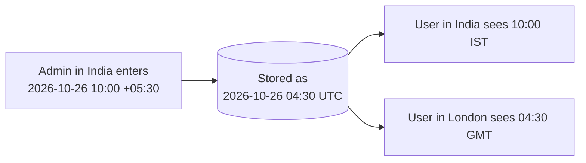

Note: `TIMESTAMPTZ` doesn't store the zone itself. It converts everything to UTC. In Java, map it to `Instant` (or `OffsetDateTime`).

> **Interview answer:** "I store instants as TIMESTAMPTZ, which normalizes to UTC, so a drop opens at the same moment for every user regardless of server or client time zone."

---

### Q12. Why not store times as epoch numbers?

Epoch means time stored as a number, for example `1793001600000` milliseconds since 1970.

| | `BIGINT` epoch | `TIMESTAMPTZ` |
|---|---|---|
| Readable in SQL | No: `1793001600000` | Yes: `2026-10-26 10:00:00+05:30` |
| Date math (`now() - interval '1 day'`) | Convert first | Built in |
| Type safety | Any number is accepted. Is it seconds or milliseconds? Mixing them up puts dates 1000× off | Only valid timestamps |
| Java mapping | `long` | `Instant`, mapped automatically by JPA |
| Storage | 8 bytes | 8 bytes |

**Where epoch is the right choice:** systems that only understand numbers. In Phase 5, the Redis waiting room uses a **sorted set whose score is the join time in epoch millis**, because sorted sets sort by numeric score.

> **Interview answer:** "In the database I use the native timestamp type for readability, date math and type safety. I use epoch where the system only understands numbers, like Redis sorted-set scores."

---

### Q13. Why no `IF NOT EXISTS` in Flyway migrations?

**Answer.** Flyway already guarantees that each migration runs **exactly once**: it records applied files in `flyway_schema_history` and skips them afterwards. Flyway makes migrations idempotent at the tool level.

`IF NOT EXISTS` would **hide bugs**:

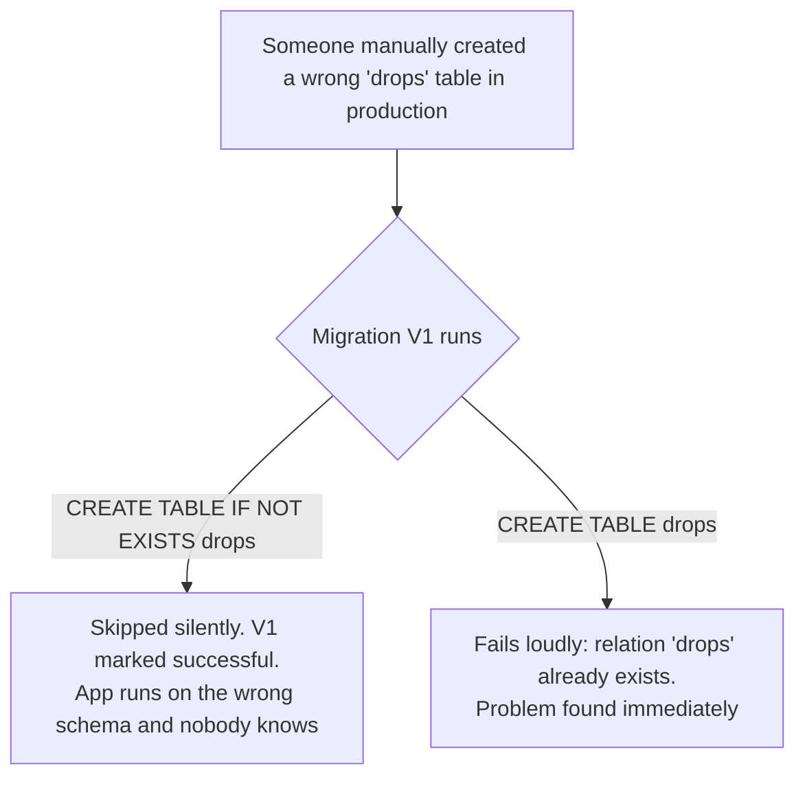

**Where `IF NOT EXISTS` is useful:** scripts run by hand, or setup scripts that no migration tool tracks.

> **Interview answer:** "Flyway tracks applied versions, so each migration runs exactly once. I avoid IF NOT EXISTS because it would mask schema drift. I'd rather fail fast."

---

### Q14. Why store `available_units` instead of computing it from orders?

**Proposal:** drop the column and compute it:
```sql
available = total_units - (SELECT SUM(quantity) FROM orders WHERE drop_id = ? AND status != 'CANCELLED')
```

**Answer.** There are two problems. The second one matters more.

**1. Performance.** A stored counter is a one-row read. The computed version scans every order for the drop, the orders table grows with every sale, and the "only 12 left" counter on the product page runs the same query for every viewer.

**2. Correctness.** Computing the value doesn't remove the race condition. It only moves it:

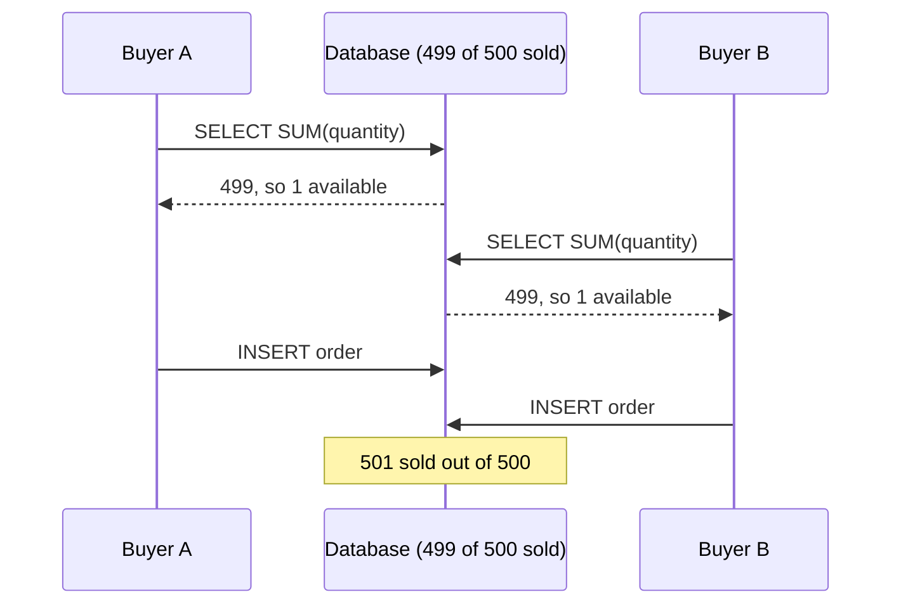

To prevent this you have to lock something, but there's no single row that represents "the stock". You'd have to lock every order row for the drop, or the whole table, which puts every buyer in line behind a slow aggregate.

With a stored counter:
- There is **one small row to lock**, or to update atomically: `UPDATE ... SET available_units = available_units - 1 WHERE available_units > 0`.
- The database can enforce `CHECK (available_units >= 0)`. A CHECK can't be written on a SUM over another table.

**The concept: denormalization.** Storing a value that could be computed, on purpose.

| | Normalized (computed) | Denormalized (stored counter) |
|---|---|---|
| Duplicated data | None | Yes |
| Cost per read | Grows with the number of orders | One row |
| What to lock | No single row, so the whole set | One row |
| Database constraint possible | No | Yes: `CHECK >= 0` |

**Keeping the duplicate correct:** decrement the counter and insert the order in **the same transaction**, so both commit or neither does. Optionally, run a periodic **reconciliation** job that verifies `total_units - SUM(orders) = available_units`.

> **Interview answer:** "Under high contention I store the counter instead of computing it. It turns a growing aggregate into a single-row read, gives me one row to lock or atomically decrement, and lets a CHECK constraint enforce non-negative stock. I keep it consistent by updating the counter and inserting the order in the same transaction."

---

### SQL patterns cheat sheet

```sql
-- Auto-generated primary key
id  BIGINT GENERATED ALWAYS AS IDENTITY PRIMARY KEY,

-- Foreign key: this row belongs to an existing row in another table
product_id  BIGINT NOT NULL REFERENCES products(id),

-- Primary key that is also a foreign key (1:1 relationship)
drop_id  BIGINT PRIMARY KEY REFERENCES drops(id),

-- Exact money
price  NUMERIC(10, 2) NOT NULL CHECK (price > 0),

-- Default value plus a rule
max_per_user  INTEGER NOT NULL DEFAULT 1 CHECK (max_per_user > 0),

-- Only allowed values (enum-like)
status  VARCHAR(20) NOT NULL CHECK (status IN ('SCHEDULED', 'LIVE', 'ENDED', 'CANCELLED')),

-- Rule across two columns: its own line after the columns
CHECK (ends_at > starts_at)

-- Composite index for frequent lookups
CREATE INDEX idx_orders_user_drop ON orders (user_id, drop_id);
```

**Syntax rules**
- Every line inside `( ... )` ends with a comma, except the last.
- `;` goes only after the closing `)`.
- A foreign key links rows ("this drop belongs to product 5"). It never copies another column's definition.
- Don't put `DEFAULT now()` on business times such as `starts_at`. They must be set deliberately.

---

### Q15. What do `@Id` and `@GeneratedValue(strategy = IDENTITY)` mean?

- **`@Id`** marks the field as the primary key. Every entity has exactly one.
- **`@GeneratedValue`** means the value is generated automatically, not set by your code.
- **`strategy`** says who generates it, and how.

| Strategy | Who makes the id | How |
|---|---|---|
| `IDENTITY` (used in flashdrop) | The database | Postgres assigns the next number on `INSERT`. Matches `GENERATED ALWAYS AS IDENTITY` |
| `SEQUENCE` | The database, fetched first | Hibernate calls `nextval(...)` before inserting. Needs a sequence object in SQL |
| `UUID` | Java | Random id such as `3f2a9c1e-...`, no database round trip |
| `AUTO` | Hibernate decides | Avoid: not explicit, may not match the schema |

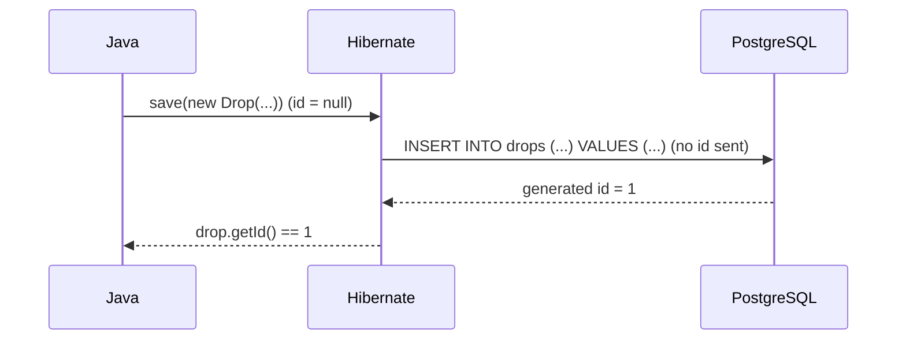

- `id` is a `Long` (nullable object), not a `long` (defaults to 0): `null` clearly means "not saved yet".
- The strategy must match the SQL. Postgres rejects an explicitly sent id for a `GENERATED ALWAYS` column.
- Trade-off: `IDENTITY` prevents Hibernate from batching inserts, because it must insert each row to learn its id. `SEQUENCE` allows batching.

> **Interview answer:** "`@Id` marks the primary key. `@GeneratedValue(IDENTITY)` means the database assigns it on insert, matching an identity column. SEQUENCE is the alternative when I need batched inserts."

---

### Q16. What do the entity annotations and Lombok's `@Getter` do?

**JPA vs. Lombok:** JPA annotations (`jakarta.persistence.*`) tell Hibernate how to map to the database. Lombok annotations (`lombok.*`) generate boilerplate Java code at compile time. They're independent tools.

**Class level**

| Annotation | From | What it does |
|---|---|---|
| `@Entity` | JPA | Marks the class as mapped to a table. Without it, Hibernate ignores the class |
| `@Table(name = "drops")` | JPA | Names the table explicitly. Otherwise Hibernate guesses from the class name (`drop`, which is also a reserved SQL word) |
| `@Getter` | Lombok | Generates `getX()` for every field |
| `@NoArgsConstructor(access = PROTECTED)` | Lombok | Generates `protected Drop() {}` for Hibernate |

**Field level: `@Column` options**

| Option | Meaning | Example |
|---|---|---|
| `name` | Column name when it differs from the field | `createdAt` maps to `created_at` |
| `nullable = false` | Documents `NOT NULL` | |
| `length = 200` | Documents `VARCHAR(200)` | |
| `insertable = false` | Never included in `INSERT` | `created_at`, filled by `DEFAULT now()` |
| `updatable = false` | Never included in `UPDATE` | Creation time never changes |

Without `@Column(name = ...)`, Spring Boot converts the field name from camelCase to snake_case (`startsAt` becomes `starts_at`). flashdrop still writes `name` explicitly, so the mapping is visible when reading the code.

**Only add an option when its reason applies.** `updatable = false` is right for `createdAt` (a fact that never changes) but a bug on `startsAt` (a schedule an admin may change): Hibernate silently leaves the column out of every UPDATE, so the change is lost without an error. Leave out options that repeat a default, such as `insertable = true`.

**What `@Getter` generates**

```java
// You write
@Getter
public class Drop {
    private Long id;
    private String name;
}

// The compiler effectively produces
public class Drop {
    private Long id;
    private String name;
    public Long getId() { return id; }
    public String getName() { return name; }
}
```

**Why `@Getter` but no `@Setter`:** setters let any code put an object in an invalid state (for example, `LIVE` after `ENDED`). Without them, every change goes through a meaningful method such as `drop.goLive()` that enforces the rules. That's **encapsulation**.

**Why never `@Data` on entities:**
- It generates setters, which breaks encapsulation.
- Its `toString()` touches lazy relations, which can cause extra queries or `LazyInitializationException`.
- Its `equals()`/`hashCode()` use fields like `id`, which is `null` before saving, so objects break inside `HashSet`s.

**Why the no-args constructor is `protected`**

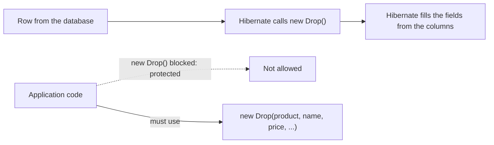

| Access | Hibernate can use it | Application code can use it |
|---|---|---|
| `public` | Yes | Yes (dangerous: half-built objects) |
| `protected` | Yes | No |
| `private` | No (JPA needs at least protected) | No |

> **Interview answer:** "JPA needs a no-args constructor to hydrate entities, so I make it protected. Application code then has to go through the full constructor, so a half-built entity can't exist. On entities I use @Getter without setters and never @Data."

---

### Q17. Why `@ManyToOne Product product` instead of `Long productId`, and what does LAZY do?

```java
@ManyToOne(fetch = FetchType.LAZY, optional = false)
@JoinColumn(name = "product_id")
private Product product;
//  @JoinColumn name: the SQL column (copied from V1)
//  type:             the entity class being referenced
//  field name:       camelCase
```

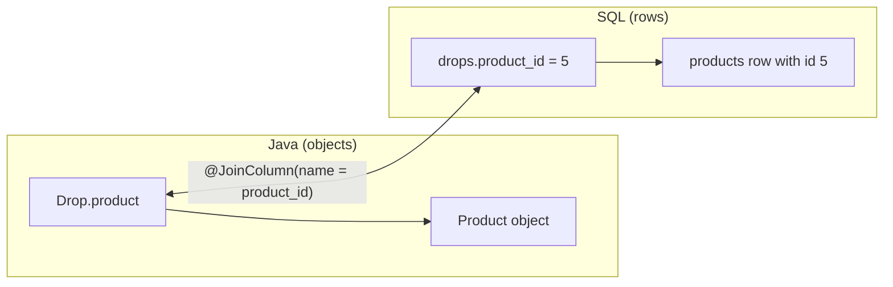

**Why an object instead of a `Long`:**
1. **Navigation:** `drop.getProduct().getName()` instead of a separate lookup.
2. **Type safety:** a `Long` could hold an order id or user id by mistake. A `Product` can only be a product.
3. **Hibernate does the work:** it reads and writes `product_id` and can join tables in queries.

**`@Column` vs `@JoinColumn`:** plain values (text, numbers, times) use `@Column(name = ...)`. Relationships use `@JoinColumn(name = "..._id")`. Either one's `name` is only needed when the Java name and the SQL name differ (`price` maps to `price` without it).

**What LAZY does:**

```java
Drop drop = dropRepo.findById(1L).orElseThrow(); // SELECT * FROM drops WHERE id = 1
drop.getProduct().getName();                     // SELECT * FROM products WHERE id = 5  (runs only now)
```

| Fetch type | Behaviour |
|---|---|
| `LAZY` | Hibernate puts a placeholder (a proxy) in the field and queries the product the first time it's used |
| `EAGER` | The product is always loaded with the drop, even when only the price is needed. Wasted work on a hot read path |

> **Interview answer:** "`@ManyToOne` maps the foreign key as an object reference, for navigation and type safety. I make it LAZY so the related entity is loaded only when accessed, which avoids unnecessary queries on hot paths."

---

### Q18. `EnumType.ORDINAL` vs `EnumType.STRING`

**ORDINAL** stores the enum constant's position: `SCHEDULED = 0, LIVE = 1, ENDED = 2, CANCELLED = 3`. A live drop is stored as `status = 1`.

Someone then inserts `PAUSED` after `SCHEDULED`:

```java
SCHEDULED,   // 0
PAUSED,      // 1  (new)
LIVE,        // 2  (was 1)
ENDED,       // 3  (was 2)
CANCELLED    // 4  (was 3)
```

| Stored value | Originally meant | Now read as |
|---|---|---|
| `1` | LIVE | PAUSED |
| `2` | ENDED | LIVE: ended drops are on sale again |
| `3` | CANCELLED | ENDED |

Every existing row silently changes meaning, with no error, just from editing the enum.

**STRING** stores the constant's name, `'LIVE'`, so adding or reordering constants changes nothing.

| | ORDINAL | STRING |
|---|---|---|
| Stored as | `1` | `'LIVE'` |
| Readable in SQL | No | Yes |
| Safe to reorder or insert constants | No: corrupts existing rows | Yes |
| Works with `CHECK (status IN ('SCHEDULED', ...))` | No | Yes |

**Caveat:** renaming a constant (`LIVE` to `ACTIVE`) still breaks STRING, because old rows say `'LIVE'`. A rename needs a migration: `UPDATE drops SET status = 'ACTIVE' WHERE status = 'LIVE'`.

> **Interview answer:** "ORDINAL stores the position, so inserting or reordering constants silently changes the meaning of existing rows. STRING stores the name, which is readable, safe to reorder and matches CHECK constraints. Renames still need a data migration."

---

### Q19. What are these classes called, and what should a constructor guarantee?

| Term | Meaning |
|---|---|
| **Entity** (JPA entity) | A class annotated with `@Entity` that maps to a table, such as "the Drop entity" |
| **ORM** (object-relational mapping) | The technique of mapping objects to tables. Hibernate is an ORM framework |
| **Domain model** | All the entities together: Product, Drop, Inventory, Order |
| **Repository** | The interface that saves and loads entities |
| **DTO** (data transfer object) | A plain class for API requests and responses. Never expose entities directly as JSON |

```
Entity class  <->  table          Drop          <->  drops
Field         <->  column         startsAt      <->  starts_at
Object        <->  row            one Drop      <->  one row
Relationship  <->  foreign key    drop.product  <->  drops.product_id
```

**A constructor guarantees a valid starting state.** It doesn't just copy values:

```java
public Drop(Product product, String name, BigDecimal price,
            Instant startsAt, Instant endsAt, int maxPerUser) {
    this.product = product;
    this.name = name;
    this.price = price;
    this.startsAt = startsAt;
    this.endsAt = endsAt;
    this.maxPerUser = maxPerUser;
    this.status = DropStatus.SCHEDULED;   // every new drop starts here
}
```

- `status` is not a parameter, so no caller can create a drop that is already `LIVE` or `ENDED`.
- Forgetting an assignment (`this.name = name`) compiles but fails at runtime on the `NOT NULL` column. Tests catch this; the compiler doesn't.
- Keep enums minimal (`SCHEDULED, LIVE, ENDED, CANCELLED`). Display labels belong in the UI. This is **YAGNI**: You Aren't Gonna Need It.

---

### Java and SQL type mapping cheat sheet

| SQL (V1) | Java |
|---|---|
| `BIGINT` | `Long` |
| `INTEGER` | `int` (or `Integer` if nullable) |
| `VARCHAR(n)` / `TEXT` | `String` |
| `NUMERIC(10,2)` | `BigDecimal` with `@Column(precision = 10, scale = 2)` |
| `TIMESTAMPTZ` | `Instant` |
| `VARCHAR` holding an enum | Enum with `@Enumerated(EnumType.STRING)` |
| Foreign key `xxx_id BIGINT` | The entity object, with `@ManyToOne` and `@JoinColumn(name = "xxx_id")` |

Naming: Java fields in camelCase (`maxPerUser`); SQL names in snake_case inside `@Column(name = "max_per_user")`.

---

### Q20. Why does Inventory have no `@GeneratedValue`?

**Answer.** `inventory.drop_id` isn't a new identity. It's the **drop's** id, copied in (a 1:1 shared key).

```
Drop #7 created       ->  drops.id = 7            generated by the database
Its inventory created ->  inventory.drop_id = 7   copied from the drop
```

If the database generated it, drop #7's stock could end up attached to drop #1. (Postgres would refuse anyway: `drop_id` has no `GENERATED ... IDENTITY`.)

| The id is... | Annotation |
|---|---|
| A new identity for this row (`products.id`, `drops.id`, `orders.id`) | `@Id @GeneratedValue(strategy = IDENTITY)` |
| Copied from another row (`inventory.drop_id`) | `@Id` only, set in the constructor |

**No "check if it exists, then insert" in Java.** The primary key already guarantees one inventory row per drop. A Java check would be a check-then-act race: two requests could both see "doesn't exist" and both insert.

```java
public Inventory(Long dropId, int totalUnits) {
    this.dropId = dropId;
    this.totalUnits = totalUnits;
    this.availableUnits = totalUnits;   // nothing sold yet: valid starting state
}
```

> **Interview answer:** "Inventory's primary key is the drop's id, a 1:1 shared key, so it's assigned rather than generated. The primary key constraint guarantees one inventory row per drop, with no check-then-act race."

---

### Q21. Why does Inventory store `Long dropId` instead of a `Drop` object?

**Answer.** Because of **module boundaries**. `Drop` lives in `catalog/` and `Inventory` lives in `inventory/`.

**Real life:** in a company, the warehouse team doesn't walk into the catalog team's office and edit their files. It keeps a reference number ("stock for drop #7") and asks the catalog team's front desk when it needs details.

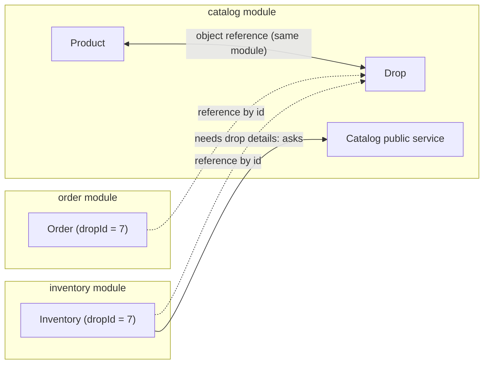

| | `@ManyToOne Drop drop` | `Long dropId` |
|---|---|---|
| Coupling | Inventory depends on catalog's internal classes | Inventory only knows a number |
| Extracting into a microservice | Hibernate can't join across separate databases | A number works anywhere, even over the network |
| Encapsulation | Inventory could reach into `drop.getProduct()...` | Must go through catalog's public service |

**Rule:** inside one module, use object references (`Drop -> Product`). Across modules, reference by id (`Inventory.dropId`, `Order.dropId`).

> **Interview answer:** "Within a module I use object references for navigation. Across module boundaries I reference by id, so modules stay loosely coupled and can be extracted into separate services with separate databases."

---

### Q22. OOP in flashdrop, with real-life examples

**Class vs. object**

| | Real life | flashdrop |
|---|---|---|
| Class: the blueprint | The design of the Air Max 1 sneaker | `public class Drop { ... }` |
| Object: a real instance | One actual pair on a shelf | `new Drop(product, "Air Max Day", ...)`; each row becomes one object |

**The four pillars**

| Pillar | Real life | flashdrop |
|---|---|---|
| **Encapsulation**: hide the inside, expose safe actions | An ATM: you can't open the cash box; `withdraw()` checks your balance first | `private` fields, no setters, `protected` no-args constructor, constructors that enforce a valid start; later `inventory.reserve(1)` |
| **Abstraction**: say *what*, hide *how* | A power socket: any plug works, whatever the power source | The `ProductRepository` interface. Spring generates the implementation |
| **Inheritance**: reuse what exists | A child inherits the family surname and house | `ProductRepository extends JpaRepository` inherits `save`, `findById`, `findAll`, ... |
| **Polymorphism**: one action, many forms | "Pay" works with UPI, card or wallet | Phase 4: `PaymentProvider` with several implementations |

**What an interface is:** a contract, meaning a list of methods with no implementation. Code depends on the contract, and any implementation can be plugged in.

```java
interface PaymentProvider {
    PaymentResult charge(Order order);
}

class MockUpiProvider implements PaymentProvider { ... }
class MockCardProvider implements PaymentProvider { ... }

// The order service calls provider.charge(order) without knowing which one it has.
```

Adding a new provider requires no change to the order service. That's the **Open/Closed principle** (SOLID, Phase 1 Step 3).

Note: entities deliberately avoid inheritance. Simple classes and composition are easier to map with JPA.

> **Interview answer (OOP):** "Encapsulation: entities expose behaviour methods, not setters. Abstraction: repositories are interfaces whose implementations Spring generates. Inheritance: repositories extend JpaRepository. Polymorphism: payment providers implement one interface, so new ones plug in without changing callers."

---

### Q23. Order: the starting status, and who owns `createdAt` vs `updatedAt`

**Starting status:** every new order starts as `PENDING_PAYMENT`, because payment hasn't happened yet. The payment flow (Phase 4) moves it on:

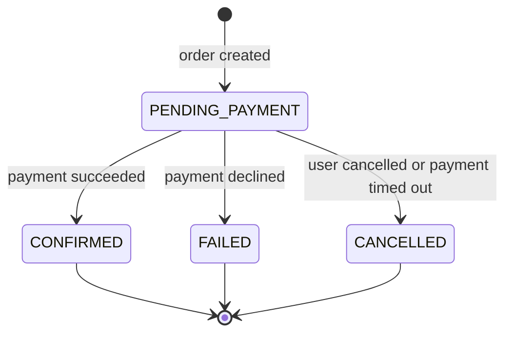

**Same-module vs cross-module mapping:** the relationship is many orders to one drop either way. `Order` is in `order/` and `Drop` is in `catalog/`, so it's mapped as `@Column(name = "drop_id") Long dropId`, not `@ManyToOne Drop drop` (Q21).

**Who writes each timestamp**

| | `createdAt` | `updatedAt` |
|---|---|---|
| Set by | The database: `DEFAULT now()` | Hibernate: `@UpdateTimestamp` |
| Hibernate must... | Leave the column out of the SQL | Write the column |
| Mapping | `insertable = false, updatable = false` | Defaults (both `true`) |

**What breaks if they're swapped**
- `createdAt` without `insertable = false`: Hibernate sends `created_at = NULL` explicitly. An explicit NULL overrides `DEFAULT now()`; a default only applies when the column is left out of the INSERT. The insert fails on NOT NULL.
- `updatedAt` with `updatable = false`: Hibernate computes "now" but never sends it, so `updated_at` silently stays at the creation time.

```java
@Column(name = "created_at", nullable = false, insertable = false, updatable = false)
private Instant createdAt;      // database owns it

@UpdateTimestamp
@Column(name = "updated_at", nullable = false)
private Instant updatedAt;      // Hibernate owns it
```

> **Interview answer:** "`insertable`/`updatable = false` means Hibernate leaves the column out of the SQL. That's right when the database owns the value, like `DEFAULT now()`, and wrong when Hibernate owns it, like `@UpdateTimestamp`."

---

### Q24. Where should a rule like "only SCHEDULED drops can go LIVE" live?

**Answer.** In the **entity**, as a method. Keeping the rule in one place is the right instinct, and the entity is the one place nobody can bypass.

**In the service, other code can skip it:**

```java
// DropService checks the rule
if (drop.getStatus() != SCHEDULED) throw ...;

// AdminService, written later, forgets the check
// RefundService has its own slightly different copy
```

**In the entity, it can't be skipped:**

```java
// Drop.java
public void goLive() {
    if (status != DropStatus.SCHEDULED) {
        throw new IllegalStateException("Drop " + id + " can't go live from " + status);
    }
    this.status = DropStatus.LIVE;
}
```

There's no `setStatus()`, so `goLive()` and its sibling methods are the only way to change the status. The object protects itself (the ATM example from Q22).

**The service coordinates and doesn't decide:**

```java
@Service
class DropService {
    @Transactional
    public void startDrop(Long dropId) {
        Drop drop = dropRepository.findById(dropId).orElseThrow();
        drop.goLive();   // the entity enforces the rule; no save() needed
    }
}
```

**Dirty checking: why no `save()` is needed**

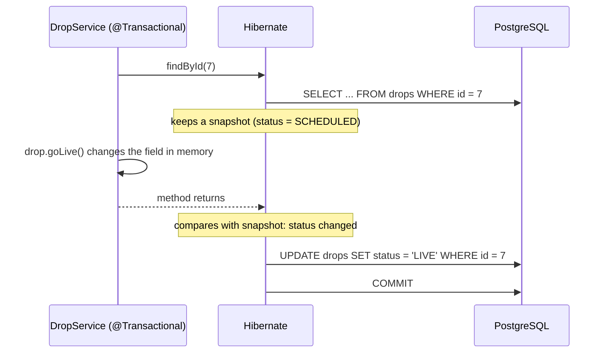

| | Anemic domain model | Rich domain model |
|---|---|---|
| Entity | Data, getters and setters only | Data plus behaviour that enforces its own rules |
| Rules live in | Services: scattered, can be skipped | The entity: one place, can't be skipped |
| Service | Does everything | Orchestrates: load, call domain methods, manage the transaction |

**What does belong in a service:** rules that span several entities or modules, such as "create an order only if inventory has stock and the drop is live".

> **Interview answer:** "Rules about one entity's own state live in the entity, behind intention-revealing methods like `goLive()`, with no setters, so they can't be bypassed. Services orchestrate: they load, call domain methods, manage the transaction, and handle rules that span entities or modules."

---

## Mistakes Log

Real mistakes made during the build, kept so they aren't repeated.

| Phase | Mistake | Fix | Lesson |
|---|---|---|---|
| 0 | Mixed indentation in the compose `redis:` block | Services at 2 spaces, properties at 4 | YAML structure is defined by indentation |
| 0 | `container name` (with a space) | `container_name` | Compose keys are exact |
| 0 | Healthcheck copied from Mongo (`--eval db.adminCommand`) | `["CMD", "redis-cli", "ping"]` | After copy-pasting, check that every line makes sense for the new service |
| 0 | `"redis-cli ping"` as one list item | `"redis-cli", "ping"` | In exec form, each word of the command is its own item |
| 0 | Redis volume at `/data/db` (Mongo's path) | `/data` | Every image has its own data directory |
| 0 | Wrote the property name as the YAML value | Nested keys with real values | The indentation is the name; only the value goes after the colon |
| 0 | `spring.redis` (missing `data:`) | `spring.data.redis` | Wrong paths are silently ignored, not reported |
| 0 | `host: localhost:6379` | `host: localhost`, plus a separate `port: 6379` | Host and port are separate settings |
| 0 | Ran curl while the app wasn't running | App in terminal 1, curl in terminal 2 | `spring-boot:run` runs in the foreground |
| 1 | Foreign-key column with no type (`product_id FOREIGN AS products.id`) | `product_id BIGINT NOT NULL REFERENCES products(id)` | Every column needs a type. A foreign key is written with `REFERENCES` |
| 1 | `price VARCHAR` | `NUMERIC(10, 2)` with `CHECK (price > 0)` | Text can't be compared numerically or used in math. Use exact decimals for money |
| 1 | `DEFAULT now()` on `starts_at` / `ends_at` | No default; the times must be given | A forgotten value would start the drop immediately |
| 1 | `ends_at` declared twice | Declare once, and add `CHECK (ends_at > starts_at)` | Postgres rejects duplicate columns |
| 1 | `DEFAULT 1 AND > 0;` | `DEFAULT 1 CHECK (max_per_user > 0),` | Rules go in `CHECK (...)`, and `;` would end the whole statement |
| 1 | Missing comma after `status`, and no allowed values | `CHECK (status IN (...)),` | Every column line needs a comma except the last |
| 1 | `created_at FOREIGN AS products.created_at` | `created_at TIMESTAMPTZ NOT NULL DEFAULT now()` | A foreign key links rows; it doesn't copy a column definition |
| 1 | `inventory.drop_id` without `PRIMARY KEY` | `drop_id BIGINT PRIMARY KEY REFERENCES drops(id)` | Without it, one drop could have two stock counters: overselling built into the schema |
| 1 | `CHECK (available_units > 0 AND available_units < total_units)` | `>= 0 AND <= total_units` | Off-by-one: a fresh drop (500/500) and selling the last unit (0) were both rejected. Run boundary value analysis on every constraint |
| 1 | `orders.drop_id REFERENCES products(id)` | `REFERENCES drops(id)` | Point each foreign key at the table the row actually belongs to |
| 1 | `drop_id` copied from the `id` line (`GENERATED ... PRIMARY KEY`) | `drop_id BIGINT NOT NULL REFERENCES drops(id)` | One primary key per table. `GENERATED` is only for the row's own id, never for a pointer |
| 1 | `REFERENCES` on `unit_price` and `created_at` | No foreign key; `unit_price` is a snapshot copy | Only `_id` columns get `REFERENCES` |
| 1 | `CREATE INDEX` written inside `CREATE TABLE` | A separate statement after `);`: `CREATE INDEX idx_orders_user_drop ON orders (user_id, drop_id);` | An index is its own statement, with a name and `ON table` |
| 1 | `=<` | `<=` | Comparison operators are written less-than or greater-than first: `<=`, `>=` |
| 1 | Leftover `KEY` after deleting `PRIMARY KEY` | Remove it | Re-read the whole line after editing it |
| 1 | Comma after the last column | No comma before `);` | Every line inside the table ends with a comma except the last |
| 1 | `private Integer product_id` with `@ManyToOne`, then `@JoinColumn(name = "product") private Long product` | `@JoinColumn(name = "product_id") private Product product` | Three slots: the SQL column name (from V1), the entity type, and a camelCase field name |
| 1 | `private Float price` with `length = 10` | `private BigDecimal price` with `precision = 10, scale = 2` | Never use floats for money. `length` is only for text |
| 1 | `updatable = false` on `startsAt` | Remove it | It silently drops schedule changes. Copy an option only if its reason applies |
| 1 | Field named `starts_at` | `startsAt` with `@Column(name = "starts_at")` | camelCase in Java, snake_case in SQL. Otherwise the getter becomes `getStarts_at()` |
| 1 | `SCHEDULED("Scheduled")` in an enum with no constructor | Plain constants: `SCHEDULED, LIVE, ENDED, CANCELLED` | Arguments need a matching enum constructor. Display labels belong in the UI (YAGNI) |
| 1 | Constructor didn't assign `name` | `this.name = name;` | It compiles but fails at runtime on `NOT NULL`. Tests catch what the compiler can't |
| 1 | `status` as a constructor parameter | `this.status = DropStatus.SCHEDULED;` | A constructor guarantees a valid starting state. Callers can't create an already-ended drop |
| 1 | `Inventory` constructor didn't set `dropId` | `this.dropId = dropId;` | A manually assigned `@Id` left `null` fails on save |
| 1 | `availableUnits` as a constructor parameter | `this.availableUnits = totalUnits;` | Otherwise a caller could create 900 available out of 500 |
| 1 | `@JoinColumn(name = "drop_id")` on `Long dropId` | `@Column(name = "drop_id", nullable = false)` | `@JoinColumn` is only for relationships. On a plain field Hibernate ignores it, so it worked only by accident |
| 1 | Column names `"user_Id"`, `"unit_Price"` | `"user_id"`, `"unit_price"` | Copy names exactly from the SQL. Code that works by accident breaks when something unrelated changes |
| 1 | `import com.flashdrop.catalog.Drop` in the order module (unused) | Remove it | Cross-module imports are the coupling that Q21 avoids |

**Takeaway from Phase 1 schema work:** "It ran without errors" isn't the same as "it's correct". Syntax errors appear immediately; logic errors only appear with data at the boundaries. Test valid and invalid rows against every constraint.
