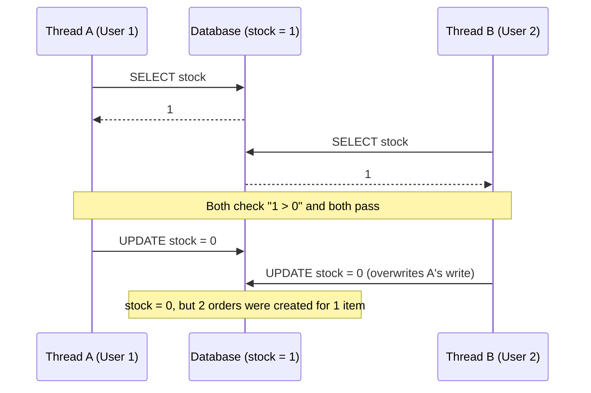
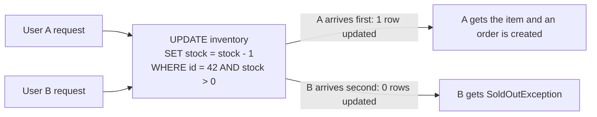
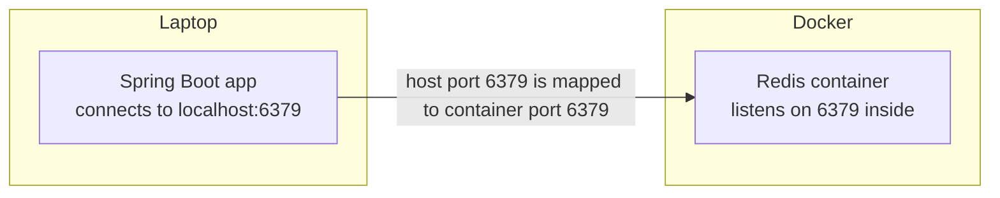
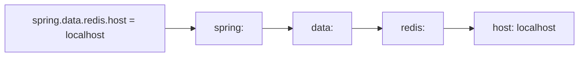
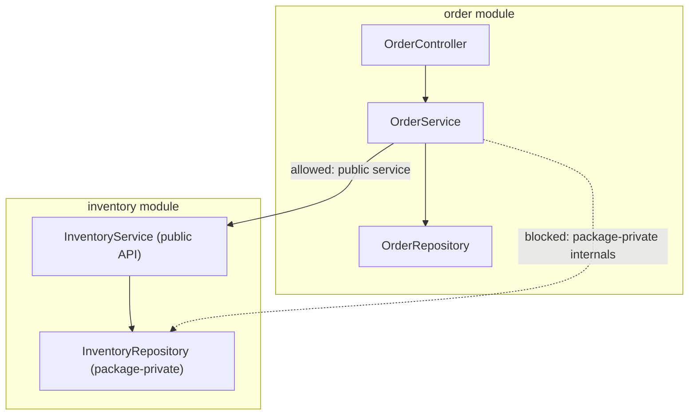
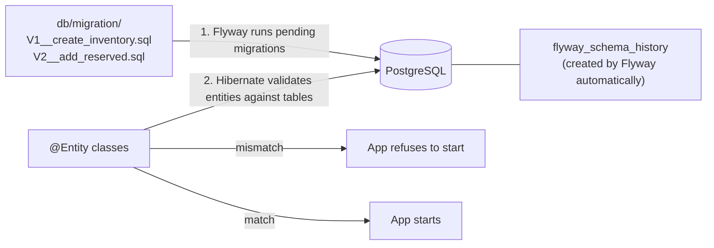

# flashdrop: Learning Notes

Questions and answers from building flashdrop, organized by phase. Each answer is written to be useful as interview prep: the concept, a diagram where it helps, and a one-line "interview answer" at the end.

> Diagrams use [Mermaid](https://mermaid.js.org/), which GitHub renders automatically. In IntelliJ, enable the Mermaid option in the Markdown plugin settings to see them in the preview.

## Contents

- [Phase 0: Setup and Foundations](#phase-0-setup-and-foundations)
  - [Q1. What goes wrong when two users buy the last item at the same time?](#q1-what-goes-wrong-when-two-users-buy-the-last-item-at-the-same-time)
  - [Q2. How does the code know which user won the atomic UPDATE?](#q2-how-does-the-code-know-which-user-won-the-atomic-update)
  - [Q3. How do Docker port mappings work, and how do I find a port?](#q3-how-do-docker-port-mappings-work-and-how-do-i-find-a-port)
  - [Q4. How does a property name like `spring.data.redis.host` turn into YAML?](#q4-how-does-a-property-name-like-springdataredishost-turn-into-yaml)
  - [Q5. Why package by feature instead of by layer?](#q5-why-package-by-feature-instead-of-by-layer)
  - [Q6. What is Hibernate, and why use Flyway with `ddl-auto: validate` instead of `update`?](#q6-what-is-hibernate-and-why-use-flyway-with-ddl-auto-validate-instead-of-update)
  - [Q7. What happens if I add an entity field but forget the migration?](#q7-what-happens-if-i-add-an-entity-field-but-forget-the-migration)
- [Mistakes Log](#mistakes-log)

---

## Phase 0: Setup and Foundations

### Q1. What goes wrong when two users buy the last item at the same time?

```java
Inventory inv = repo.findById(id);
if (inv.getStock() > 0) {
    inv.setStock(inv.getStock() - 1);
    repo.save(inv);
}
```

**Answer.** Both requests read `stock = 1` before either one writes. Both pass the `if` check, both compute `1 - 1 = 0`, and both save `0`. The stock ends at **0, not -1**, so the database looks healthy, but **two items were sold when only one existed**. That's what makes the bug dangerous: nothing looks wrong until two customers both expect the item.



**Vocabulary**

| Term | Meaning |
|---|---|
| Race condition | The result depends on the timing of threads |
| Check-then-act | The check (`if`) and the action (update) are separate steps, so another thread can run in between them |
| Lost update | One write silently overwrites another write that was based on the same old value |

**Three fixes** (built and benchmarked in Phase 2)

| Strategy | How it works | What the losing request experiences |
|---|---|---|
| Pessimistic lock | `SELECT ... FOR UPDATE` locks the row until the transaction ends | It waits, then reads `stock = 0` |
| Optimistic lock | A `@Version` column; the update succeeds only if the version is unchanged | Its save fails, so it retries or gives up |
| Atomic conditional update | `UPDATE ... SET stock = stock - 1 WHERE id = ? AND stock > 0` | It updates 0 rows, which means sold out |

> **Interview answer:** "It's a check-then-act race that causes a lost update. Both threads read the same stale value, so we oversell while the stock still looks correct. I'd fix it with a pessimistic lock, an optimistic version check, or an atomic conditional UPDATE, depending on how much contention there is."

---

### Q2. How does the code know which user won the atomic UPDATE?

**Answer.** An `UPDATE` returns the **number of rows it changed**. The database applies the two updates to the row one at a time. The first one matches `stock > 0` and changes 1 row. The second one sees `stock = 0`, matches nothing, and changes 0 rows.



```java
@Modifying
@Query("UPDATE Inventory i SET i.stock = i.stock - 1 WHERE i.id = :id AND i.stock > 0")
int decrementIfAvailable(@Param("id") Long id);   // returns rows affected

int updated = inventoryRepo.decrementIfAvailable(id);
if (updated == 0) {
    throw new SoldOutException(id);
}
```

**Why it works:** the check and the write happen in **one atomic statement inside the database**. There's no gap between them for another request to slip into.

> **Interview answer:** "I push the check into the WHERE clause so the database enforces it atomically, and I use the affected-row count to decide whether this request won."

---

### Q3. How do Docker port mappings work, and how do I find a port?

**Answer.** In `docker-compose.yml`, `ports` uses the format **`HOST:CONTAINER`**.

```yaml
ports:
  - "6379:6379"
#    ↑      ↑
#  laptop  container
```



The app connects to the **left** (host) number. With `"6380:6379"`, the app would use `localhost:6380`, while Redis still listens on 6379 inside the container.

**Three ways to find a port**

1. Read the `ports:` entry in `docker-compose.yml`.
2. Run `docker compose ps` and look at the PORTS column, for example `0.0.0.0:6379->6379/tcp`.
3. Know the defaults:

| Service | Default port |
|---|---|
| Redis | 6379 |
| PostgreSQL | 5432 |
| MongoDB | 27017 |
| Kafka | 9092 |
| Spring Boot | 8080 |

**Related gotchas**
- Editing `docker-compose.yml` doesn't start anything. Run `docker compose up -d` afterwards.
- `./mvnw spring-boot:run` keeps running in the foreground. Run `curl` from a **second terminal** while the app is up.

---

### Q4. How does a property name like `spring.data.redis.host` turn into YAML?

**Answer.** Each dot becomes one level of indentation, and **only the value** goes after the last colon. The property name never appears as text inside the YAML. **The indentation is the name.**



| `.properties` (one line) | YAML (nested) |
|---|---|
| `spring.data.redis.host=localhost`<br/>`spring.data.redis.port=6379` | <pre>spring:<br/>  data:<br/>    redis:<br/>      host: localhost<br/>      port: 6379</pre> |

**Rules**
- Indent with spaces, never tabs. Siblings must line up exactly.
- `host` is only the machine name (`localhost`). The port goes on its own line.
- A wrong path such as `spring.redis.host` doesn't crash the app. Spring Boot just **ignores** it and uses defaults, so the app can look like it works while your config is being ignored.

---

### Q5. Why package by feature instead of by layer?

```
By layer                          By feature (flashdrop)
├── controllers/                  ├── catalog/
│   ├── OrderController           ├── inventory/
│   └── InventoryController       │   ├── InventoryController
├── services/                     │   ├── InventoryService
│   ├── OrderService              │   ├── InventoryRepository
│   └── InventoryService          │   └── Inventory
└── repositories/                 ├── order/
    ├── OrderRepository           ├── payment/
    └── InventoryRepository       └── common/
```



**Answer.**
1. **High cohesion.** Everything about a feature lives in one folder. A change to order logic touches one place instead of four folders.
2. **Encapsulation.** Classes can be package-private (no `public` keyword), so other modules have to go through the feature's public service and can't reach into its internals.
3. **Easy extraction.** Moving `payment/` into its own microservice (Phase 4) is roughly "move one folder". With package-by-layer, payment code would be spread across every layer folder.

Smaller files are a side benefit, but layered packaging also gives you separate files, so that isn't the main reason.

> **Interview answer:** "I package by feature for high cohesion and clear module boundaries. That keeps changes local and lets each module be extracted into a service later."

---

### Q6. What is Hibernate, and why use Flyway with `ddl-auto: validate` instead of `update`?

**What Hibernate is.** JPA is the Java standard for mapping classes to database tables. **Hibernate is the library that implements JPA**, and it comes with `spring-boot-starter-data-jpa`. It reads `@Entity` classes and generates the SQL for `save()`, `findById()` and so on.

```java
@Entity
class Inventory {
    @Id Long id;
    int stock;      // maps to the inventory.stock column
}
```

**What `ddl-auto` controls:** whether Hibernate may create or change tables.

| Value | What Hibernate does |
|---|---|
| `create` / `create-drop` | Drops and recreates tables on every start (all data lost) |
| `update` | Adds whatever is missing compared with the entities |
| `validate` | Changes nothing. Checks that tables match the entities and refuses to start if they don't |
| `none` | Does nothing |

**Why not `update`?**
- **It only adds and never cleans up.** Renaming `stock` → `quantity` adds a new empty column and leaves the old one, with its data, behind.
- **It can't migrate data**, for example filling a new column from existing rows.
- **There's no history and no review.** Environments drift apart, and nobody knows what changed when.
- **It's unsafe in production.** Teams don't let an app change production tables on startup.

**Who does what in flashdrop**



**Do I need to create a table to track migrations?** No. Flyway creates `flyway_schema_history` automatically on first run. It records which `V…` files have already been applied, so each migration runs exactly once.

> **Interview answer:** "Schema changes are versioned SQL migrations in Git, run by Flyway and reviewed in PRs. Hibernate is set to `validate`, so if an entity doesn't match the schema, the app fails fast at startup instead of in production."

---

### Q7. What happens if I add an entity field but forget the migration?

**Scenario:** with `ddl-auto: validate`, you add `private int reserved;` to `Inventory` but don't write a Flyway migration.

**Answer.** The app **refuses to start**, with an error like:

```
Schema-validation: missing column [reserved] in table [inventory]
```

The important part is **when** it fails: at startup, on your laptop, within seconds. Not in production, when a customer's request finally reaches that code path. That's the "fail fast" principle.

---

## Mistakes Log

Real mistakes made during the build, kept so they aren't repeated.

| Phase | Mistake | Fix | Lesson |
|---|---|---|---|
| 0 | Mixed indentation in the compose `redis:` block | Services at 2 spaces, properties at 4 | YAML structure is defined by indentation |
| 0 | `container name` (with a space) | `container_name` | Compose keys are exact |
| 0 | Healthcheck copied from Mongo (`--eval db.adminCommand`) | `["CMD", "redis-cli", "ping"]` | After copy-pasting, check that every line makes sense for the new service |
| 0 | `"redis-cli ping"` as one list item | `"redis-cli", "ping"` | In exec form, each word of the command is its own item |
| 0 | Redis volume at `/data/db` (Mongo's path) | `/data` | Every image has its own data directory |
| 0 | Wrote the property name as the YAML value | Nested keys with real values | The indentation is the name; only the value goes after the colon |
| 0 | `spring.redis` (missing `data:`) | `spring.data.redis` | Wrong paths are silently ignored, not reported |
| 0 | `host: localhost:6379` | `host: localhost`, plus a separate `port: 6379` | Host and port are separate settings |
| 0 | Ran curl while the app wasn't running | App in terminal 1, curl in terminal 2 | `spring-boot:run` runs in the foreground |
